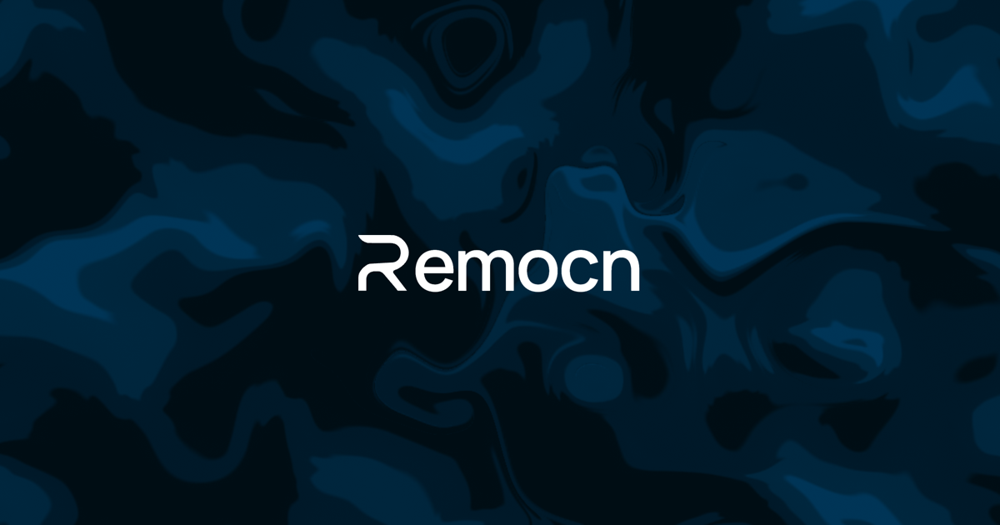

<p align="center">
  
</p>


# Remocn: Claude Code plugin & agent skill for making Remotion videos

Remocn is a Claude Code plugin, agent skill and MCP server for making Remotion videos from 932 MIT-licensed Remotion components. Your agent plans a storyboard, installs the components into your Remotion project with the shadcn CLI and writes the video: a product demo, a launch video, a changelog video or a social clip.

**Works with Claude Code, Codex, Cursor, GitHub Copilot and any agent that loads skills or connects to MCP.**

```bash
npx skills add Remocn/remocn
```

## Install

Pick one. The plugin already includes the skill and the MCP server.

| You use | Install | You get |
|---|---|---|
| Claude Code | `/plugin install remocn --marketplace Remocn/remocn` | The `/remocn:video` workflow, helper agents, the skill and the MCP tools |
| Codex | `codex plugin marketplace add Remocn/remocn` then `codex plugin add remocn@remocn` | The same plugin |
| Cursor, Copilot or any agent that loads skills | `npx skills add Remocn/remocn` | The [agent skill](https://remocn.dev/docs/getting-started/agent-skill) |
| Any MCP client | `https://remocn.dev/mcp` | The [MCP server](https://remocn.dev/docs/getting-started/mcp-server): search, docs, video plans, previews |
| Your own hands | `npx shadcn@latest add @remocn/blur-reveal` | One component's source in your repo |

Remotion is a prerequisite. The plugin creates a project in an empty folder; by hand it's `npx create-video@latest`.

## Demo

<p align="center">
  <a href="https://cdn.remocn.dev/videos/remocn-v3.mp4"></a>
  <br />
  <sub>▶ <a href="https://cdn.remocn.dev/videos/remocn-v3.mp4">Watch the MP4</a> · built with Remotion and Remocn components</sub>
</p>

## Make a Remotion video with Claude Code

```text
/remocn:video 30-second product demo for Tasklane, a shared task inbox for small teams
```

`/remocn:video` runs brief → storyboard → install → compose → visual check → hand-off. It stops after the storyboard so you can change direction before any code is written. Then the `scene-reviewer` agent renders stills of every beat and checks them for clipped text, empty frames and low contrast. The video lands in `src/videos/<slug>/index.tsx`; render it with `npx remotion render <slug>` or open it in [Remocn Studio](https://remocn.studio).

Also in the plugin: `/remocn:changelog` turns git tags, commits or merged PRs into a changelog video, `/remocn:add <name>` installs and places one component, `/remocn:studio` opens the project in Remocn Studio. [Plugin docs](https://remocn.dev/docs/getting-started/plugin).

## What you can make

| Video | Guide |
|---|---|
| Product demo video from your codebase | [Product demo](https://remocn.dev/docs/guides/product-demo) |
| Launch video | [Launch video](https://remocn.dev/docs/guides/launch-video) |
| Changelog video | [Changelog video](https://remocn.dev/docs/guides/changelog-video) |
| Feature announcement | [Feature announcement](https://remocn.dev/docs/guides/feature-announcement) |
| Teaser | [Teaser](https://remocn.dev/docs/guides/teaser) |
| Showcase reel | [Showcase reel](https://remocn.dev/docs/guides/showcase-reel) |

The registry has text animations, transitions, backgrounds, shaders, camera and physics shots, captions, filters, UI primitives, app-screen simulations (AI chat composers, Claude Code, v0, terminals), animated icons and full video templates (Release Teaser, Brand Guidelines, Workflow Console, Product Showcase, Order Flow).

## Gallery

<table>
  <tr>
    <td align="center"><a href="https://cdn.remocn.dev/videos/typography.mp4"></a><br /><sub>Text animations</sub></td>
    <td align="center"><a href="https://cdn.remocn.dev/videos/new-transitions.mp4"></a><br /><sub>Transitions</sub></td>
    <td align="center"><a href="https://cdn.remocn.dev/videos/paper-shaders.mp4"></a><br /><sub>Shader backgrounds</sub></td>
  </tr>
  <tr>
    <td align="center"><a href="https://cdn.remocn.dev/videos/remocn-chat.mp4"></a><br /><sub>Chat primitives</sub></td>
    <td align="center"><a href="https://cdn.remocn.dev/videos/remocn-ui.mp4"></a><br /><sub>UI primitives</sub></td>
    <td align="center"><a href="https://cdn.remocn.dev/videos/remocn-icons.mp4"></a><br /><sub>Animated icons</sub></td>
  </tr>
</table>

Every clip above was made with Remocn components. More in the [video changelog](https://remocn.dev/changelog/video), and every component has a live, scrubbable preview in the [docs](https://remocn.dev/docs).

## Craft rules: what we ban

Agent-made Remotion videos look generic for the same few reasons. The Remocn skill and the plugin's `scene-reviewer` hold your agent's own additions to these rules ([why AI videos look generic](https://remocn.dev/docs/guides/non-generic-ai-video), [Craft](https://remocn.dev/docs/craft)):

- **No glow halos** or blurred color blobs behind headings
- **No gradient-filled text.** Mark the one word that matters with weight, the accent or a highlight
- **No decorative ALL-CAPS or wide letter-spacing.** Sentence case, default tracking
- **No more than one accent color**
- **No panels that all pop in on the same frame.** Stagger entrances, one focal action per beat
- **No clipped animations.** Every component states its length in frames; a `Sequence` is never shorter
- **No invented generic dashboards.** Show a believable product surface or your real screenshots
- **No lorem or "Scene A" placeholder copy**
- **No `Math.random()`.** Randomness is seeded, so every render is the same
- **No invented props or durations.** The agent reads the component's page before it uses it

Components whose effect is the point (`tracking-in`, shader gradients) are exempt; the rules apply to what the agent writes by hand.

## Remotion's official skills vs Remocn

They answer different questions and work together.

| | Remotion's official skills and plugin | Remocn plugin and skill |
|---|---|---|
| Answers | How to write correct Remotion code | What goes on screen: which component for each beat, for how many frames |
| Install | `npx skills add remotion-dev/skills` | `/plugin install remocn --marketplace Remocn/remocn` or `npx skills add Remocn/remocn` |
| Output | Code the agent writes from scratch | Code built from installed component source files, in your repo |
| Ready-made scenes | No | 932 components and full video templates |
| Cost | Free; Remotion may need a company license | Free, MIT; Remotion's license still applies |

We ran both setups on the same 15-second brief on November 10, 2026, with timings, costs and both MP4s: [the test](https://remocn.dev/docs/getting-started/plugin#test-the-same-15-second-promo-with-and-without-remocn).

## Remotion MCP server (hosted)

Remocn runs a hosted MCP server for making videos with Remotion at `https://remocn.dev/mcp`. Add the URL to Claude Code, Cursor, Codex or any MCP client. There's no API key and no account.

| | |
|---|---|
| URL | `https://remocn.dev/mcp` |
| Transport | Streamable HTTP |
| Auth | None |
| Access | Read-only; it does not render video |
| License | MIT, free |
| Clients | Claude Code, Claude Desktop and claude.ai, Cursor, VS Code, Codex, any Streamable HTTP client |

Tools:

- `search_components`: find Remocn components by query, vibe or length in frames
- `get_component`: one component's docs as Markdown: props, usage example, install command
- `plan_video`: turn a brief into a beat-by-beat storyboard with component picks
- `preview_component`: a live preview link, played inline in clients that support MCP Apps

Claude Code:

```bash
claude mcp add --transport http remocn https://remocn.dev/mcp
```

Codex:

```bash
codex mcp add remocn --url https://remocn.dev/mcp
```

Cursor (`.cursor/mcp.json`):

```json
{
  "mcpServers": {
    "remocn": { "url": "https://remocn.dev/mcp" }
  }
}
```

Your agent installs what it picks with `npx shadcn@latest add @remocn/<name>`, and you render with Remotion as usual. Setup for every client: [MCP server docs](https://remocn.dev/docs/getting-started/mcp-server). Comparing options? See [Remotion MCP servers compared](https://remocn.dev/docs/guides/remotion-mcp-servers).

## Remocn Studio

Rather direct the video than write it? [Remocn Studio](https://remocn.studio) is a free, open-source macOS app where your own coding agent (Claude Code, Codex, GitHub Copilot or Grok) builds the video from Remocn components while you watch the live preview and export.

## Why Remocn

- **Production-ready Remotion code.** Every component uses `useCurrentFrame()`, `interpolate()` and `spring()` correctly, with no `Math.random()` traps that break rendering.
- **Own your code.** Components are copied into your project by the shadcn CLI, not installed as a runtime dependency. Change them however you like.
- **Live previews.** Each component page mounts a real `@remotion/player` you can scrub frame by frame.
- **Built for agents.** [`/llms.txt`](https://remocn.dev/llms.txt), [`/llms-components.txt`](https://remocn.dev/llms-components.txt) and a Markdown version of every docs page (append `.md`). The skill reads the live index, so it never goes stale.

## FAQ

### Is there a Claude Code plugin or skill for creating Remotion videos?

Yes. Remocn's plugin (`/plugin install remocn --marketplace Remocn/remocn`) adds the `/remocn:video` workflow and 932 ready-made components; the skill (`npx skills add Remocn/remocn`) adds the catalog alone. Remotion also maintains official skills that teach Claude its API, and the two work together.

### Does it work in Cursor or Codex?

Yes. The plugin installs in Claude Code and Codex. In Cursor, install the skill with `npx skills add Remocn/remocn` or add the MCP server at `https://remocn.dev/mcp`.

### Is Remocn free? Is it official?

Remocn is free and MIT-licensed, with no account, servers or usage limits; you render wherever you run Remotion. It is an independent community project, not affiliated with Remotion or shadcn. Remotion keeps its own license, and larger companies may need a Remotion company license.

### Is it a video editor or text-to-video API?

No. There's no timeline and no hosted rendering, and it doesn't edit footage. The agent writes React code from components into your Remotion project.

## Sponsors

Remocn is free and MIT-licensed. These sponsors keep the registry growing and the renders fast.

<!-- sponsors:start -->
<table align="center">
  <tbody>
    <tr>
      <td colspan="15" width="850" align="center"><a href="https://neon.com/"><picture><source media="(prefers-color-scheme: dark)" srcset="https://remocn.dev/sponsors/neon-dark.svg" /></picture></a></td>
    </tr>
    <tr>
      <td colspan="3" width="170" align="center"><a href="https://21st.dev/"><picture><source media="(prefers-color-scheme: dark)" srcset="https://remocn.dev/sponsors/21st-dark.svg" /></picture></a></td>
      <td colspan="3" width="170" align="center"><a href="https://pro.reactbits.dev/"><picture><source media="(prefers-color-scheme: dark)" srcset="https://remocn.dev/sponsors/reactbits-dark.svg" /></picture></a></td>
      <td colspan="3" width="170" align="center"><a href="https://reui.io/"><picture><source media="(prefers-color-scheme: dark)" srcset="https://remocn.dev/sponsors/reui-dark.svg" /></picture></a></td>
      <td colspan="3" width="170" align="center"><a href="https://shadcnblocks.com/"><picture><source media="(prefers-color-scheme: dark)" srcset="https://remocn.dev/sponsors/shadcnblocks-dark.svg" /></picture></a></td>
      <td colspan="3" width="170" align="center"><a href="https://shadcnuikit.com/"><picture><source media="(prefers-color-scheme: dark)" srcset="https://remocn.dev/sponsors/shadcnuikit-dark.svg" /></picture></a></td>
    </tr>
  </tbody>
</table>
<!-- sponsors:end -->

[Become a sponsor](https://remocn.dev/sponsors) to get your logo on the landing page, in the docs sidebar and here.
